<a href="README.md">🇧🇷 Ler em português</a>

I build backend and cloud software, and I start with the problem before the code. I've shipped REST APIs, authentication and multi-tenancy systems, and AI-powered serverless workflows on AWS, in hackathons where the goal was to go from a vague idea to something people can actually use.

My background includes a Full Stack program, a technical residency, collaborative projects and many hackathons. It shapes how I work: I think about who the user is, what their pain is, and what the smallest useful version is that solves the problem.

## ✨ What I bring to the team

- **Product vision, beyond implementation.** I use Lean Inception to align the team on the problem, persona and MVP before opening the editor. At the Artemisia × Ada Tech hackathon, my team was the only one to bring user-centered storytelling and a visible agile process to the pitch.
- **Spec-driven development with AI agents.** I write clear specs, user stories and acceptance criteria, build with AI agents from them, and own what goes to production: I review, test and validate. That is how a small team gains speed without losing structure.
- **Solid backend and security foundations.** Authentication, authorization, JWT and multi-tenancy are where I feel at home.
- **Cloud and applied AI.** Serverless architectures on AWS, document processing with Textract, LLMs on Bedrock, RAG and event-driven pipelines.
- **Communication.** I can explain a technical decision to a teammate, a mentor or a review panel, and I take on the "glue" work (spec, QA, demo) that gets a project across the finish line.

## 🚀 Featured projects

### 🏆 Extrato Popular — AI-powered financial insights for low-income consumers

**1st place** · Artemisia × Ada Tech Hackathon (Elas+ Tech)

A RAG-based platform that turns confusing financial data into plain-language guidance for people who are usually left out of fintechs. Team of four.

- Owned authentication, security and multi-tenancy (Java 21, Spring Boot 3, Spring Security, JWT).
- Ran a streamlined Lean Inception and kept the product centered on the end user; our persona was the thread of the storytelling in the final pitch.
- Delivered **297 automated tests** with **95.2% code coverage** (JaCoCo) and **93.3% compliance** with the call's evaluation criteria.

`Java 21` `Spring Boot 3` `Spring Security` `JWT` `Multi-tenancy` `RAG`

### 📄 DocuSmart Seguros — Insurance claims processing on AWS

**Hack2Hire** · Escola da Nuvem (EDN)

An end-to-end serverless solution that automates claim intake and triage, with a customer portal and an analyst portal. AI summarizes each claim so a human analyst can approve, deny or escalate the case, keeping a person in the decision.

- When the team went from five people to one, I took over the technical spec (16 pages), the architecture, QA and the final demo.
- Designed the flow with Amazon Bedrock (Nova Pro), Strands Agents, Textract, SQS with dead-letter queues, API Gateway, S3 and DynamoDB.
- Wrote user journeys, business rules and user stories with acceptance criteria, and ran end-to-end tests.

`AWS Lambda` `Bedrock` `Strands Agents` `Textract` `SQS/DLQ` `API Gateway` `DynamoDB` `S3`

### ⚡ Agents for Ecommerce — Event-driven pipeline with an LLM

**deco.studio Hackathon**

An event-driven pipeline built with Cloudflare Workers and Queues, a NestJS service running in Docker, and an LLM integration (Gemini).

`Cloudflare Workers` `Queues` `NestJS` `Docker` `Gemini`

## 🛠️ Technologies

View as text

| Area | Technologies |
| :-- | :-- |
| **Backend and APIs** | Java · Spring Boot · Spring Security · Node.js · NestJS · Express · REST · JWT · Swagger/OpenAPI |
| **Cloud, AI and automation** | AWS (Lambda, S3, SQS, DynamoDB, API Gateway, Bedrock, Textract) · Cloudflare Workers · RAG · Agentic workflows · Docker |
| **Frontend** | React · TypeScript · JavaScript · HTML · CSS |
| **Databases** | PostgreSQL · MongoDB · DynamoDB · Prisma · Sequelize · SQL |
| **Ways of working** | Lean Inception · Spec-driven development (OpenSpec) · Agile · Git/GitHub · Linux · AI-assisted workflows |

## 🌱 Earlier projects

Projects from my Full Stack training, where I learned the fundamentals by building:

- 🛒 **Buenas Shop** — e-commerce in React + TypeScript with cart logic and Context API · [Demo](#)
- 📊 **Financial Dashboard** — dashboard in React + Recharts consuming a REST API
- 🌐 **Mulheres na Tecnologia API** — CRUD API with Node.js, Express and MongoDB · [Front-end demo](#)
- 🕷️ **Web Scraper** — scraping experiment with Bun + JavaScript · [Demo](#)

## 🎓 Education and certifications

- **AWS Certified Cloud Practitioner** (valid through 2028)
- Java Back-end Track — Ada, Elas+ Tech
- Full Stack Development — Capacita Brasil / C-Jovem, with a 3-month technical residency in React
- Service Desk — ITIL 4, Active Directory, ticketing practices and knowledge base
- Bachelor's degree in Tourism — IFCE
- English C2 · Intermediate Spanish · Native Portuguese

## 🔭 Currently

## 📫 Let's talk

  
  

I like building software that solves real problems for real people, and figuring out which problem to solve first.