<a href="README.en.md">🇺🇸 Read in English</a>

Desenvolvo software de backend e cloud e começo pelo problema antes do código. Já entreguei APIs REST, sistemas de autenticação e multi-tenancy e fluxos serverless com IA na AWS, em hackathons onde o objetivo era sair de uma ideia vaga e chegar a algo que as pessoas conseguem usar de verdade.

Minha formação passa por Full Stack, residência técnica, projetos colaborativos e muitos hackathons. Isso molda o meu jeito de trabalhar: penso em quem é o usuário, qual é a dor dele e qual é a menor versão útil que resolve o problema.

## ✨ O que eu levo para o time

- **Visão de produto, além da implementação.** Uso Lean Inception para alinhar o time sobre problema, persona e MVP antes de abrir o editor. No hackathon Artemisia × Ada Tech, meu time foi o único a levar storytelling centrado no usuário e um processo ágil visível para o pitch.
- **Spec-driven development com agentes de IA.** Escrevo especificações claras, user stories e critérios de aceite, construo com agentes de IA a partir delas e respondo pelo que vai para produção: reviso, testo e valido. É assim que um time pequeno ganha velocidade sem perder estrutura.
- **Base sólida em backend e segurança.** Autenticação, autorização, JWT e multi-tenancy são onde eu me sinto em casa.
- **Cloud e IA aplicada.** Arquiteturas serverless na AWS, processamento de documentos com Textract, LLMs no Bedrock, RAG e pipelines orientados a eventos.
- **Comunicação.** Explico uma decisão técnica para um colega, uma mentora ou uma banca e assumo o trabalho de "cola" (spec, QA, demo) que faz um projeto chegar ao final.

## 🚀 Projetos em destaque

### 🏆 Extrato Popular — Insights financeiros com IA para consumidores de baixa renda

**1º lugar** · Hackathon Artemisia × Ada Tech (Elas+ Tech)

Plataforma com RAG que transforma dados financeiros confusos em orientações em linguagem simples para pessoas que costumam ficar de fora das fintechs. Time de quatro pessoas.

- Responsável por autenticação, segurança e multi-tenancy (Java 21, Spring Boot 3, Spring Security, JWT).
- Conduzi uma Lean Inception enxuta e mantive o produto centrado no usuário final; nossa persona foi o fio condutor do storytelling no pitch.
- Entreguei **297 testes automatizados** com **95,2% de cobertura** de código (JaCoCo) e **93,3% de conformidade** com os critérios de avaliação do edital.

`Java 21` `Spring Boot 3` `Spring Security` `JWT` `Multi-tenancy` `RAG`

### 📄 DocuSmart Seguros — Processamento de sinistros na AWS

**Hack2Hire** · Escola da Nuvem (EDN)

Solução serverless ponta a ponta que automatiza a entrada e a triagem de sinistros, com portal do cliente e portal do analista. A IA resume cada sinistro para que um analista humano aceite, negue ou escale o caso, mantendo uma pessoa na decisão.

- Quando o time passou de cinco para uma pessoa, assumi a especificação técnica (16 páginas), a arquitetura, o QA e a demo final.
- Desenhei o fluxo com Amazon Bedrock (Nova Pro), Strands Agents, Textract, SQS com dead-letter queues, API Gateway, S3 e DynamoDB.
- Escrevi jornadas de usuário, regras de negócio e user stories com critérios de aceite, e executei testes end-to-end.

`AWS Lambda` `Bedrock` `Strands Agents` `Textract` `SQS/DLQ` `API Gateway` `DynamoDB` `S3`

### ⚡ Agents for Ecommerce — Pipeline orientado a eventos com LLM

**Hackathon deco.studio**

Pipeline orientado a eventos com Cloudflare Workers e Queues, um serviço em NestJS rodando em Docker e integração com LLM (Gemini).

`Cloudflare Workers` `Queues` `NestJS` `Docker` `Gemini`

## 🛠️ Tecnologias

Ver em texto

| Área | Tecnologias |
| :-- | :-- |
| **Backend e APIs** | Java · Spring Boot · Spring Security · Node.js · NestJS · Express · REST · JWT · Swagger/OpenAPI |
| **Cloud, IA e automação** | AWS (Lambda, S3, SQS, DynamoDB, API Gateway, Bedrock, Textract) · Cloudflare Workers · RAG · Fluxos com agentes · Docker |
| **Frontend** | React · TypeScript · JavaScript · HTML · CSS |
| **Bancos de dados** | PostgreSQL · MongoDB · DynamoDB · Prisma · Sequelize · SQL |
| **Jeito de trabalhar** | Lean Inception · Spec-driven development (OpenSpec) · Agile · Git/GitHub · Linux · Fluxos assistidos por IA |

## 🌱 Projetos anteriores

Projetos da minha formação Full Stack, onde aprendi os fundamentos construindo:

- 🛒 **Buenas Shop** — e-commerce em React + TypeScript com lógica de carrinho e Context API · [Demo](#)
- 📊 **Financial Dashboard** — dashboard em React + Recharts consumindo uma API REST
- 🌐 **Mulheres na Tecnologia API** — API CRUD com Node.js, Express e MongoDB · [Demo do front-end](#)
- 🕷️ **Web Scraper** — experimento de scraping com Bun + JavaScript · [Demo](#)

## 🎓 Formação e certificações

- **AWS Certified Cloud Practitioner** (válida até 2028)
- Trilha Back-end Java — Ada, Elas+ Tech
- Desenvolvimento Full Stack — Capacita Brasil / C-Jovem, com residência técnica de 3 meses em React
- Service Desk — ITIL 4, Active Directory, práticas de ticketing e base de conhecimento
- Bacharelado em Turismo — IFCE
- Inglês C2 · Espanhol intermediário

## 🔭 Atualmente

## 📫 Vamos conversar

  
  

Gosto de construir software que resolve problemas reais para pessoas reais e de descobrir qual problema resolver primeiro.